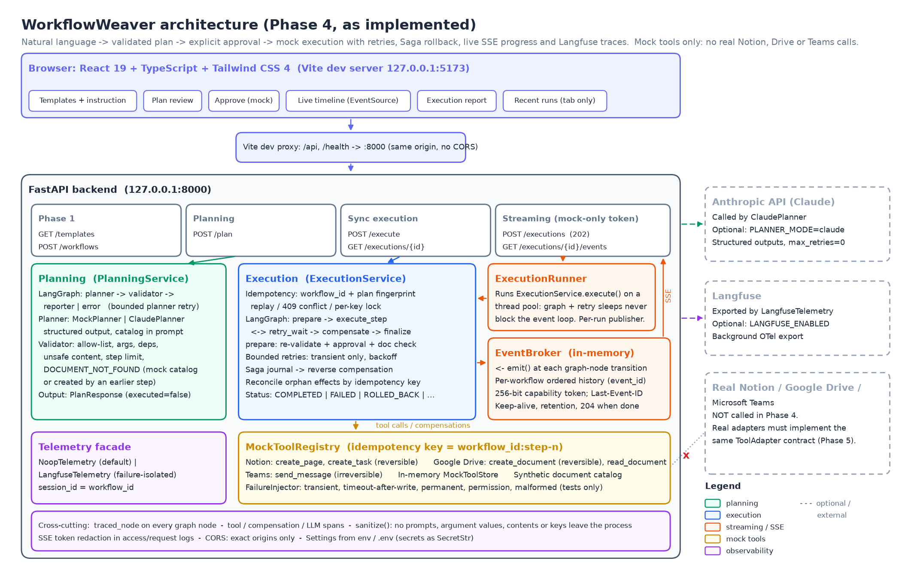

# WorkflowWeaver

FDE Capstone: an AI workflow orchestrator that turns unstructured input (meeting notes, backlogs, incident reports) into executed multi-tool workflows.

## Architecture



| Layer | Technology |
|---|---|
| API | FastAPI: REST + Server-Sent Events for live progress |
| Orchestration | LangGraph: planning graph + execution graph (retries, Saga compensation); Claude or mock planner |
| Integrations | Server-selected mode: **mock** (default), **dry_run**, or **real** (Notion MCP, Google Drive MCP, Teams webhook; foundation only, tested against fakes) |
| Observability | Langfuse Python SDK v5 (optional, failure-isolated) |
| Frontend | React 19 + TypeScript + Vite 8 + Tailwind CSS 4 (`frontend/`) |

## Status

| Phase | Scope | State |
|---|---|---|
| 1 | FastAPI skeleton, templates, `PLANNED` workflow records | Done |
| 2 | LangGraph planning agent: natural language → validated plan | Done |
| 3 | LangGraph execution graph over **mock** tools: approval gate, bounded retries, idempotency, Saga compensation | **Done (mock only)** |
| 4 | Langfuse observability, SSE live progress, React + Tailwind UI, mock document validation, integration and reliability testing | **Done (mock only)** |
| 5.1 | Real-integration foundation: integration modes, MCP + webhook clients, approved destinations, write authorization, secret redaction | **Done (fakes only; no real service connected)** |
| 5.2+ | Connect and verify real Notion / Drive MCP servers and Teams webhooks, durable persistence, user authentication | Planned |

[docs/ARCHITECTURE.md](docs/ARCHITECTURE.md) describes the implementation in detail: both LangGraph graphs, state, the SSE transport, observability, security boundaries, a real worked example, test inventory, limitations and Phase 5 recommendations.

## Quick start (two terminals, Windows PowerShell)

```powershell
# Terminal 1 - backend (http://127.0.0.1:8000, docs at /docs)
cd C:\Projects\workflowweaver\backend
$env:PLANNER_MODE = "mock"
.\.venv\Scripts\python.exe -m uvicorn app.main:app --host 127.0.0.1 --port 8000

# Terminal 2 - frontend (http://127.0.0.1:5173)
cd C:\Projects\workflowweaver\frontend
npm install
npm run dev
```

Open http://127.0.0.1:5173, pick a template, click **Generate Plan**, review it, approve, and watch the live timeline and report. First-time backend setup is described in [Setup](#setup-windows-powershell).

## Endpoints

| Method | Path | Phase | Description |
|---|---|---|---|
| GET | `/health` | 1 | Liveness check |
| GET | `/api/v1/workflows/templates` | 1 | Meeting-to-Tasks, Sprint Planning, Incident Response |
| POST | `/api/v1/workflows` | 1 | Validates input, returns a UUID and status `PLANNED` |
| POST | `/api/v1/workflows/plan` | 2 | Runs the LangGraph planner; returns a validated plan |
| POST | `/api/v1/workflows/execute` | 3 | Executes an approved plan against **mock** tools |
| GET | `/api/v1/workflows/executions/{workflow_id}` | 3 | Stored result of a finished execution (404 if unknown) |
| POST | `/api/v1/workflows/executions` | 4 | Start a **mock** execution in the background; returns 202 + stream URL/token |
| GET | `/api/v1/workflows/executions/{workflow_id}/events` | 4 | Live progress as Server-Sent Events (token required) |
| GET | `/api/v1/integrations/status` | 5.1 | Integration mode, write switches and destination **aliases** (never URLs, ids or secrets) |

`POST /api/v1/workflows/plan` status codes:

| HTTP | `status` | Meaning |
|---|---|---|
| 200 | `PLANNED` | Plan generated and validated. **Not executed.** |
| 422 | `INVALID` | Plan generated but rejected by the validator; see `validation.issues` (incl. `DOCUMENT_NOT_FOUND`, below) |
| 422 | — | Request body invalid (FastAPI `detail` body) |
| 502 | `FAILED` | Planner failed (timeout, API error, invalid LLM output) after retries |
| 503 | — | Planner not configured (e.g. `PLANNER_MODE=claude` without `ANTHROPIC_MODEL`) |

`POST /api/v1/workflows/execute` status codes:

| HTTP | `status` | Meaning |
|---|---|---|
| 200 | `COMPLETED` | Every step succeeded |
| 403 | `REJECTED` | `approval.approved` is false; nothing executed |
| 422 | `REJECTED` | Plan failed re-validation (`validation.issues`); nothing executed |
| 422 | — | Request body invalid (e.g. `approval.mode` other than `mock`) |
| 409 | — | `workflow_id` already executed with a **different** plan |
| 502 | `FAILED` | A step failed before any side effect; nothing to undo |
| 502 | `ROLLED_BACK` | A step failed; all completed effects were compensated |
| 502 | `PARTIALLY_ROLLED_BACK` | Reversible effects undone; a non-reversible one (Teams message) remains |
| 502 | `COMPENSATION_FAILED` | A compensation also failed; manual review required |
| 503 | — | `MOCK_EXECUTION_ENABLED=false` |

A duplicate request (same `workflow_id` and plan) returns the stored response with `replayed: true` and the same HTTP status, without calling any tool.

Interactive docs: http://127.0.0.1:8000/docs

## Setup (Windows PowerShell)

```powershell
cd C:\Projects\workflowweaver\backend
py -3.11 -m venv .venv          # skip if .venv already exists
.\.venv\Scripts\python.exe -m pip install --upgrade pip
.\.venv\Scripts\python.exe -m pip install -r requirements.txt
```

## Configuration

Settings come from environment variables, or from `C:\Projects\workflowweaver\.env` (copy `.env.example`). Shell variables win over `.env`.

| Variable | Default | Purpose |
|---|---|---|
| `PLANNER_MODE` | `mock` | `mock` (no key, no network) or `claude` |
| `ANTHROPIC_API_KEY` | — | Required for `claude`. Read by the Anthropic SDK only; never logged |
| `ANTHROPIC_MODEL` | — | Required for `claude` (e.g. `claude-opus-5`). No default in code |
| `ANTHROPIC_MAX_TOKENS` | `8000` | Output cap per planning call |
| `PLANNER_TIMEOUT_SECONDS` | `60` | Per-request timeout for Claude |
| `MAX_WORKFLOW_STEPS` | `10` | Plans with more steps are rejected |
| `MAX_PLANNING_ATTEMPTS` | `2` | Planner attempts for retryable failures |
| `MOCK_EXECUTION_ENABLED` | `true` | `false`: `/execute` and `/executions` return 503, and planning skips the mock document check |
| `EXECUTION_MAX_ATTEMPTS` | `3` | Attempts per step (and per compensation) for transient errors (1–5) |
| `EXECUTION_BACKOFF_BASE_SECONDS` | `0.2` | First retry delay; doubles each attempt |
| `EXECUTION_BACKOFF_MAX_SECONDS` | `2.0` | Cap on any single retry delay |
| `EXECUTION_BACKOFF_JITTER` | `true` | Delay drawn uniformly from [d/2, d] |
| `EXECUTION_WORKER_THREADS` | `4` | Worker threads for background (streamed) executions |
| `SSE_HEARTBEAT_SECONDS` | `15` | Keep-alive comment interval on idle streams |
| `SSE_RETENTION_SECONDS` | `300` | How long a finished stream remains available for reconnects |
| `SSE_MAX_CHANNELS` | `1000` | Max streams held in memory |
| `CORS_ALLOW_ORIGINS` | dev: Vite origins | Exact origins allowed to call the API from a browser (not needed with the Vite proxy) |
| `LANGFUSE_ENABLED` | `false` | Send traces to Langfuse |
| `LANGFUSE_PUBLIC_KEY` | — | Langfuse project public key |
| `LANGFUSE_SECRET_KEY` | — | Langfuse project secret key (secret; never logged) |
| `LANGFUSE_BASE_URL` | SDK default | e.g. `https://cloud.langfuse.com`, `https://us.cloud.langfuse.com`, or self-hosted |
| `INTEGRATION_MODE` | `mock` | `mock`, `dry_run` or `real`; see [Real integrations](#real-integrations-phase-51-foundation) |
| `REAL_WRITES_ENABLED` | `false` | Kill switch for side effects in real mode |
| `REAL_WRITE_AUTHORIZATION_TOKEN` | — | Operator token required (header `X-Integration-Authorization`) for real writes (secret) |
| `INTEGRATION_CONNECT_TIMEOUT_SECONDS` / `INTEGRATION_TIMEOUT_SECONDS` | `5` / `20` | Timeouts for every MCP / webhook request |
| `NOTION_MCP_URL`, `NOTION_MCP_AUTH_TOKEN` | — | Notion MCP server (Streamable HTTP; https, or http on loopback) and its bearer token (secret) |
| `NOTION_MCP_TOOL_ALLOWLIST`, `NOTION_TOOL_*` | `API-post-page,API-patch-page` | The only MCP tools that may be called, and which one does what |
| `NOTION_DESTINATIONS`, `NOTION_DEFAULT_PAGE_PARENT`, `NOTION_TASK_DATABASE` | `{}` | Approved destinations: JSON alias → page/database id |
| `GOOGLE_DRIVE_MCP_URL`, `GOOGLE_DRIVE_MCP_AUTH_TOKEN`, `GOOGLE_DRIVE_MCP_TOOL_ALLOWLIST`, `GOOGLE_DRIVE_TOOL_*` | — | Google Drive MCP server, token, allowlist and tool names |
| `GOOGLE_DRIVE_DESTINATIONS`, `GOOGLE_DRIVE_DEFAULT_FOLDER` | `{}` | Approved folders: JSON alias → folder id (writes **and** reads are confined to them) |
| `TEAMS_WEBHOOK_URLS`, `TEAMS_DEFAULT_CHANNEL` | — | Secret JSON alias → Teams webhook URL (https only); approved channels are its aliases |

Claude Code's login does **not** give your application an API key. Create one in the Claude Console and set it only in your shell or in `.env`.

## Run tests

```powershell
# Backend: 401 tests (includes live-server SSE and end-to-end scenarios on 127.0.0.1,
# and Phase 5.1 integration tests against fake MCP servers / webhooks)
cd C:\Projects\workflowweaver\backend
.\.venv\Scripts\python.exe -m pytest -q

# End-to-end report: real uvicorn server, 3 templates + fault scenarios, PASS/FAIL per scenario
.\.venv\Scripts\python.exe -m scripts.e2e_check

# Frontend: 31 tests, type check, production build
cd C:\Projects\workflowweaver\frontend
npm test
npm run typecheck
npm run build
```

Tests never call the Claude API or any real Notion / Google Drive / Teams service. The Claude planner is tested with a fake client, `ANTHROPIC_API_KEY` is removed from the environment for every test, and telemetry is pinned to a no-op. Integration tests use an in-memory fake MCP server, `httpx.MockTransport` and a recording webhook sender. An autouse fixture (`tests/conftest.py`) removes integration env vars and **blocks every non-loopback connection** — sync and async httpx, `socket.connect`, DNS lookups (so also urllib and any SDK) — so a test that tries to reach a real service fails. The only network traffic is to servers the tests start on `127.0.0.1`.

## Start the API

Mock planner (no API key needed):

```powershell
cd C:\Projects\workflowweaver\backend
$env:PLANNER_MODE = "mock"
.\.venv\Scripts\python.exe -m uvicorn app.main:app --reload --host 127.0.0.1 --port 8000
```

Claude planner (current PowerShell session only; the key is not saved anywhere):

```powershell
cd C:\Projects\workflowweaver\backend
$env:PLANNER_MODE = "claude"
$env:ANTHROPIC_MODEL = "claude-opus-5"
$env:ANTHROPIC_API_KEY = Read-Host "Anthropic API key" -AsSecureString | ForEach-Object { [System.Net.NetworkCredential]::new("", $_).Password }
.\.venv\Scripts\python.exe -m uvicorn app.main:app --reload --host 127.0.0.1 --port 8000
```

## Try the planner

```powershell
$body = @{
  name        = "Sprint sync"
  instruction = "Read meeting notes, create a Notion project page, save a summary to Google Drive, and notify the team in Microsoft Teams."
} | ConvertTo-Json
Invoke-RestMethod -Method Post -Uri http://127.0.0.1:8000/api/v1/workflows/plan -ContentType "application/json" -Body $body | ConvertTo-Json -Depth 6
```

A rejected plan (unsupported tool) returns HTTP 422, which `Invoke-RestMethod` raises as an error. To see the body:

```powershell
$body = @{ instruction = "Create a Jira issue and notify the team in Teams" } | ConvertTo-Json
try { Invoke-RestMethod -Method Post -Uri http://127.0.0.1:8000/api/v1/workflows/plan -ContentType "application/json" -Body $body }
catch { $_.ErrorDetails.Message }
```

Trace the graph state after every node (mock planner, no server needed):

```powershell
cd C:\Projects\workflowweaver\backend
.\.venv\Scripts\python.exe -m scripts.trace_graph
.\.venv\Scripts\python.exe -m scripts.trace_graph "Create a Jira issue and notify Teams"
.\.venv\Scripts\python.exe -m scripts.trace_graph --mermaid
```

## Try mock execution (Phase 3)

```powershell
$body = @{
  workflow_id = [guid]::NewGuid().ToString()
  approval    = @{ approved = $true; mode = "mock"; approved_by = "synthetic.reviewer" }
  plan        = @{
    summary = "Meeting notes to Notion page and Teams notice"
    steps   = @(
      @{ step_number = 1; integration = "google_drive"; action = "read_document"; arguments = @{ document_name = "Synthetic standup notes" } },
      @{ step_number = 2; integration = "notion"; action = "create_page"; arguments = @{ title = "Sprint 42 kickoff"; content = "Synthetic notes" }; depends_on = @(1) },
      @{ step_number = 3; integration = "teams"; action = "send_message"; arguments = @{ message = "Sprint 42 page is ready"; channel = "synthetic-team" }; depends_on = @(2) }
    )
  }
} | ConvertTo-Json -Depth 6
Invoke-RestMethod -Method Post -Uri http://127.0.0.1:8000/api/v1/workflows/execute -ContentType "application/json" -Body $body | ConvertTo-Json -Depth 6
```

Response (abridged): `status: COMPLETED`, one `step_results` entry per step with a synthetic `resource_id` such as `mock-notion-page-505a1d07ddc4`, `attempts: {"1":1,"2":1,"3":1}`, empty `errors` and `compensation_results`. Posting the same body again returns `replayed: true`.

Synthetic Drive documents available to `read_document`: `Synthetic standup notes`, `Synthetic sprint backlog`, `Synthetic incident report` (single source: `app/agents/synthetic_documents.py`), or a document created by an earlier `create_document` step in the same plan (exact title).

**Missing documents are caught before execution.** In mock execution mode, every `read_document` name must match the catalog exactly (as the mock Drive adapter does), or match the title of an earlier `create_document` step. Otherwise:
- `/plan` returns 422 `INVALID` with a `DOCUMENT_NOT_FOUND` issue. The message lists the available documents, or says "Did you mean …?" when only capitalisation differs.
- `/execute` and `/executions` reject such a client-supplied plan in `prepare`, as `REJECTED` with no tool calls.

The adapter's runtime `DOCUMENT_NOT_FOUND` check is still the authoritative last line of defence. It is permanent, so it is not retried, and earlier effects are rolled back. Tests exercise it with `ExecutionService(document_precheck=False)`.

**Mock planner.**
- A Drive read uses the document the instruction names: a quoted name, otherwise a catalog name mentioned verbatim, otherwise the phrase used. There is no fuzzy matching.
- Titles come from the workflow's subject, e.g. `Action items: Synthetic standup notes`, `Sprint backlog: project page`.

**Claude planner.** In mock execution mode, the system prompt lists the synthetic document *names*. It never includes contents, ids or keys. Claude is told to use exact names and never to substitute a different document.

### Execution graph

```
START -> prepare --(rejected)----------------------------------------> finalize -> END
            \--(ok)--> execute_step --(ok, more steps)--> execute_step
                            |   \--(ok, last step)---------------> finalize
                            |   \--(transient, attempts left)--> retry_wait -> execute_step
                            \--(failed, effects journaled)--> compensate -> finalize
                             \--(failed, nothing to undo)---------------> finalize
```

- **prepare** re-validates the plan with the Phase 2 validator (the client's plan is not trusted), checks every action has an adapter, then checks approval.
- **execute_step** makes exactly one tool attempt. Steps run sequentially in `step_number` order, which satisfies `depends_on` (dependencies must point to earlier steps).
- **Retries**: only `transient` errors are retried, up to `EXECUTION_MAX_ATTEMPTS`, with capped exponential backoff. `permanent` and `permission` errors fail immediately.
- **Saga journal**: every successful step with a side effect is journaled. On failure, **compensate** undoes the journal in reverse order (compensations are retried for transient errors too). Read-only steps are not journaled; Teams messages are reported as `NOT_COMPENSATABLE`.
- **Reconcile**: if a step fails after its effect happened (e.g. timeout after the write), the engine looks up the effect by idempotency key and journals it, so it is still rolled back.
- **Idempotency**: tool calls use the key `{workflow_id}:step-{n}`; repeating a key returns the original result (`replayed: true`) without a second effect. Requests are deduplicated by `workflow_id` (per-key lock, so concurrent duplicates execute once).

Failure injection (`FailureInjector`: `transient`, `transient_after_effect`, `permanent`, `permission_denied`, `malformed_result`) exists for tests only. The API never accepts it, and `create_tool_registry` refuses it when `APP_ENV=production`.

## Frontend (React + TypeScript + Tailwind)

`frontend/` is a Vite app that uses the real API: `GET /health`, `GET /templates`, `POST /plan`, `POST /executions`, the SSE stream, and `GET /executions/{id}` for the report. Its TypeScript types (`src/api/types.ts`) mirror the Pydantic models field for field.

Flow: pick a template or type an instruction → **Generate Plan** → review the validated steps, integrations and dependencies (or validator issues) → enter *Approved by*, tick the confirmation, and click **Approve and Execute Mock Workflow** → watch the live step badges and event timeline → read the final report (attempts, errors, compensation results).

Requires Node.js ≥ 22.13 (tested with 22.14).

```powershell
# Terminal 1 - backend
cd C:\Projects\workflowweaver\backend
$env:PLANNER_MODE = "mock"
.\.venv\Scripts\python.exe -m uvicorn app.main:app --host 127.0.0.1 --port 8000

# Terminal 2 - frontend (first time: npm install)
cd C:\Projects\workflowweaver\frontend
npm install
npm run dev          # http://127.0.0.1:5173
```

Other scripts: `npm test` (Vitest + Testing Library), `npm run typecheck`, `npm run build` (type check + production build to `dist/`), `npm run preview`.

**How the browser reaches the API.** By default the browser only talks to `http://127.0.0.1:5173`, and the Vite dev server proxies `/api` and `/health` to the backend (`WW_BACKEND_URL`, default `http://127.0.0.1:8000`). That is same-origin, so no CORS is involved, and the SSE stream passes through the proxy unbuffered. To call the API directly instead, set `VITE_API_BASE_URL=http://127.0.0.1:8000` in `frontend/.env.local`. The backend then allows only the origins in `CORS_ALLOW_ORIGINS` (in development, the two Vite origins by default): GET/POST, `Content-Type`, `Last-Event-ID` and `X-Stream-Token` headers, no credentials.

**Secrets.** The frontend has no secrets and needs none. `VITE_*` variables are compiled into the public bundle, so never put Anthropic or Langfuse keys in any frontend `.env` file. The SSE `stream_token` is the per-run capability described below. It is kept in memory only.

**UI states.**
- API reachable or unreachable; templates loading or failed (you can still type an instruction).
- Inline form validation (same limits as the backend); planning spinner.
- Validator rejection (issues listed, execution not offered); planner failure.
- Execution start errors (e.g. 409).
- Live / reconnecting (the browser retries automatically and replays missed events) / disconnected (manual **Reconnect** resumes after the last event; **Check final result** fetches the report).
- Report loading or unavailable. A REJECTED run has no stored report, so its outcome is shown from the final stream event.

Every step and workflow badge comes from real stream events: pending, running, succeeded, failed, retrying, compensating, rolled back, not reversible, compensation failed, skipped.

**Recent runs** covers the current browser tab only, because the API has no workflow-history endpoint.

## Live progress (SSE)

`POST /api/v1/workflows/execute` (synchronous) is unchanged. For live progress, send the **same request body** to `POST /api/v1/workflows/executions`:

| HTTP | Meaning |
|---|---|
| 202 | Started. Body: `workflow_id`, `stream_url`, `stream_token`, `result_url`, `access_model: "mock-capability-token"` |
| 409 | `workflow_id` already executed with a different plan, or its stream is still active |
| 422 | Invalid body (same rules as `/execute`) |
| 503 | `MOCK_EXECUTION_ENABLED=false`, `APP_ENV=production`, or `SSE_MAX_CHANNELS` reached |

Then open `stream_url` (`GET /api/v1/workflows/executions/{workflow_id}/events?access_token=...`):

| HTTP | Meaning |
|---|---|
| 200 | `text/event-stream`; ends after `workflow_completed` or `workflow_failed` |
| 204 | Stream finished and the client already has every event (tells `EventSource` to stop reconnecting) |
| 404 | Unknown workflow, expired stream, or wrong/missing token (deliberately indistinguishable) |
| 503 | Streaming disabled (see above) |

The final `ExecutionResponse` is available at `result_url` once the run finishes, exactly as for `/execute`.

### Event contract

```
id: 4
event: step_failed
data: {"event_id":4,"workflow_id":"...","event_type":"step_failed","step_number":2,"timestamp":"2026-11-04T03:14:49.865218Z","metadata":{"attempt":1,"error_code":"TOOL_TIMEOUT","error_kind":"transient","retryable":true,"will_retry":true,"retries_exhausted":false}}
```

`event_id` is a per-workflow sequence (1, 2, 3, ...) and the SSE `id`. Events are always delivered in `event_id` order. Every event is emitted **inside the LangGraph node that performs the transition**; none are synthesised from the final result.

| `event_type` | Emitted by node | `step_number` | Key `metadata` |
|---|---|---|---|
| `workflow_started` | `prepare` (plan valid and approved) | — | `step_count`, `steps[{step_number, integration, action, depends_on}]`, `max_attempts` |
| `step_started` | `execute_step`, before each tool attempt | yes | `attempt`, `integration`, `action` |
| `step_succeeded` | `execute_step` | yes | `attempt`, `resource_id`, `replayed` |
| `step_failed` | `execute_step`, after **each** failed attempt | yes | `attempt`, `error_code`, `error_kind`, `retryable`, `will_retry`, `retries_exhausted` |
| `retry_scheduled` | `retry_wait` (before sleeping) or `compensate` | yes | `phase` (`execution`/`compensation`), `failed_attempt`, `next_attempt`, `delay_seconds`, `error_code` |
| `compensation_started` | `compensate`, per journaled step (reverse order) | yes | `integration`, `action`, `effect`, `resource_id` |
| `compensation_completed` | `compensate` | yes | `status` (`COMPENSATED`/`ALREADY_COMPENSATED`/`NOT_COMPENSATABLE`), `attempts` |
| `compensation_failed` | `compensate` | yes | `status`, `attempts`, `error_codes` |
| `workflow_completed` | `finalize` | — | `status: COMPLETED`, `attempts`, `step_statuses`, ... |
| `workflow_failed` | `finalize` | — | `status` (`FAILED`/`ROLLED_BACK`/`PARTIALLY_ROLLED_BACK`/`COMPENSATION_FAILED`/`REJECTED`), `failed_step`, `step_statuses`, `compensation_statuses`, `error_codes`, `validation_issue_codes` |

Special cases:
- A **rejected** request (not approved or invalid plan) emits only `workflow_failed` with `status: REJECTED`.
- A **duplicate** request that was already finished doesn't re-run the graph. It emits one terminal event with `replayed: true`.
- An **unexpected server error** emits `workflow_failed` with `{"status": "ERROR", "error_code": "INTERNAL_ERROR"}`.

**Never in events**: instruction or prompt text, tool argument values, document contents, error message text, credentials. Metadata is also passed through the observability sanitiser.

### How it works

```
POST /executions --> ExecutionRunner (ThreadPoolExecutor) --> worker thread:
                       set_publisher(channel)  [ContextVar, this run only]
                       ExecutionService.execute -> LangGraph nodes -> emit(...)
                                                                 |
                       EventChannel.publish: lock, append history, loop.call_soon_threadsafe
                                                                 v
GET /executions/{id}/events --> subscribe(after Last-Event-ID): backlog + asyncio.Queue --> SSE
```

- **Event loop is never blocked.** The graph and its retry sleeps run on worker threads. The SSE handler only awaits its queue.
- **Events are scoped to one run.** The publisher is a `ContextVar` set only in the worker thread running that run. The synchronous `/execute` endpoint, and any other workflow running at the same time, can't publish into the stream.
- **Ordering.** Publishing is serialised per workflow, and each subscriber's queue is fed in FIFO order. Subscribing takes the backlog snapshot and registers the queue under the same lock, so a subscriber never sees a gap or a duplicate.
- **Disconnects.** Starlette cancels the stream generator and the subscriber is removed. **The execution keeps running.** Its result stays at `result_url`, and the stream can be reopened.
- **Reconnection.** The browser `EventSource` reconnects automatically (`retry: 3000`) and sends `Last-Event-ID`. The server replays every event after that id. Once the stream has ended and the client has everything, the server returns 204, which stops further reconnects. Clients should also call `close()` on the terminal event.
- **Heartbeats.** Idle streams receive a `: keep-alive` comment every `SSE_HEARTBEAT_SECONDS`.

### Security model (mock only)

- `stream_token` is an unguessable 256-bit, per-workflow capability. It is returned only to the caller of `POST /executions` and compared in constant time. A token for workflow A doesn't open workflow B.
- It is **not user authentication**. Anyone holding the URL can read that one stream. Tokens in query strings can end up in proxy or browser logs. The backend redacts `access_token=` values from the uvicorn access log and the httpx request log (`app/core/log_redaction.py`); a reverse proxy in front of it needs the same treatment.
- Streaming endpoints return **503 when `APP_ENV=production`**. A production deployment needs real authentication (OIDC/session) with per-user authorization on workflows, and the token should move to a header or cookie.
- The Phase 3 `GET /executions/{workflow_id}` result endpoint keeps its existing behaviour: no token, lookup by unguessable UUID.

### Limitations

- In-memory and single-process: streams and history are lost on restart, and won't work across multiple uvicorn workers or instances. Use one worker, or replace the broker with Redis Streams or similar.
- History is bounded: 2,000 events per workflow; the terminal event is always kept. Finished streams are evicted after `SSE_RETENTION_SECONDS`.
- When all `EXECUTION_WORKER_THREADS` are busy, new runs queue and their streams stay quiet until a thread frees up.
- Failure injection is test-only, so retries and rollbacks can't be triggered through the API. See the live-server tests in `tests/test_sse.py`.

### Verify (PowerShell)

Terminal 1:

```powershell
cd C:\Projects\workflowweaver\backend
$env:PLANNER_MODE = "mock"
.\.venv\Scripts\python.exe -m uvicorn app.main:app --host 127.0.0.1 --port 8000
```

Terminal 2 (`curl.exe` ships with Windows 11; `-N` disables buffering):

```powershell
$base = "http://127.0.0.1:8000"
$plan = Invoke-RestMethod -Method Post -Uri "$base/api/v1/workflows/plan" -ContentType "application/json" -Body (@{ instruction = "Read meeting notes, create a Notion project page, save a summary to Google Drive, and notify the team in Microsoft Teams." } | ConvertTo-Json)
$exec = @{ workflow_id = $plan.workflow_id; plan = @{ summary = $plan.summary; steps = $plan.planned_steps }; approval = @{ approved = $true; mode = "mock"; approved_by = "synthetic.reviewer" } } | ConvertTo-Json -Depth 8
$start = Invoke-RestMethod -Method Post -Uri "$base/api/v1/workflows/executions" -ContentType "application/json" -Body $exec
curl.exe -N "$base$($start.stream_url)"
(Invoke-RestMethod "$base$($start.result_url)").status                                                     # COMPLETED
curl.exe -s -o NUL -w "%{http_code}`n" -H "Last-Event-ID: 99" "$base$($start.stream_url)"                  # 204
curl.exe -s -o NUL -w "%{http_code}`n" "$base/api/v1/workflows/executions/$($plan.workflow_id)/events?access_token=wrong"  # 404
```

End-to-end reliability check: a real uvicorn server on a free local port, over HTTP and SSE, with mock tools and synthetic fault injection configured in code. It covers all three templates, transient retry with proof of live delivery, an idempotent retry after a timeout, retry exhaustion, permanent failure with reverse rollback, partial rollback, compensation failure, duplicate replay, and the `DOCUMENT_NOT_FOUND` negative case. It prints PASS/FAIL per scenario and exits non-zero on failure. The same scenarios run in pytest as `tests/test_e2e_live.py`.

```powershell
cd C:\Projects\workflowweaver\backend
.\.venv\Scripts\python.exe -m scripts.e2e_check
```

Retries, rollback, live delivery during a retry backoff, and disconnects (real uvicorn server on a local port):

```powershell
cd C:\Projects\workflowweaver\backend
.\.venv\Scripts\python.exe -m pytest tests/test_sse.py -v
```

## Observability (Langfuse)

Tracing uses the Langfuse Python SDK v5 (`langfuse==5.1.0`, OpenTelemetry based) behind a small facade in `backend/app/observability/`. It is **off by default**.

Enable it (current PowerShell session only):

```powershell
cd C:\Projects\workflowweaver\backend
$env:LANGFUSE_ENABLED = "true"
$env:LANGFUSE_PUBLIC_KEY = "pk-lf-..."
$env:LANGFUSE_SECRET_KEY = Read-Host "Langfuse secret key" -AsSecureString | ForEach-Object { [System.Net.NetworkCredential]::new("", $_).Password }
$env:LANGFUSE_BASE_URL = "https://cloud.langfuse.com"
.\.venv\Scripts\python.exe -m scripts.langfuse_check
```

`scripts.langfuse_check` runs `auth_check()`, then one mock planning request and one mock execution (one injected retry plus a rollback), flushes, and prints a session id. In Langfuse, open **Sessions** and search for that id.

What is traced (every observation carries `workflow_id`, and `session_id = workflow_id` so planning and execution of one workflow are grouped):

| Observation | Type | Created in |
|---|---|---|
| `planning.request` | agent (trace root) | `PlanningService.run` |
| `planning.planner` / `.validator` / `.reporter` / `.error` | chain | each planning LangGraph node (`traced_node`) |
| `claude.messages.parse` | generation: model, `max_tokens`, token usage, stop reason | `ClaudePlanner.plan` |
| `execution.request` | agent (trace root): final status, attempts, error codes, compensation statuses | `ExecutionService.execute` |
| `execution.prepare` / `.execute_step` / `.retry_wait` / `.compensate` / `.finalize` | chain, with `step_number` | each execution LangGraph node |
| `tool.<integration>.<action>` | tool: attempt, effect, resource id, error code | one per mock tool attempt |
| `compensation.<integration>.<action>` | tool: attempt, outcome | one per compensation attempt |
| `execution.retry_scheduled`, `execution.compensation_retry_scheduled` | event: failed attempt, delay, error code | `retry_wait` node / compensation loop |
| `execution.effect_reconciled`, `execution.outcome` | event | reconcile / end of request |

Latency is recorded on every observation (span timing plus `latency_ms` metadata). Levels: `WARNING` for retryable errors, rollbacks and rejections; `ERROR` for permanent tool errors and `COMPENSATION_FAILED`.

**Never sent**: instruction text, system prompt, tool argument values, document contents, error message text, `approved_by`, or keys. Only lengths, argument *names*, ids, codes, counts and timings are sent. A sanitiser (`observability/sanitize.py`) scrubs every payload anyway (secret-named keys, content keys, `sk-ant-`/`sk-lf-`/bearer/JWT/webhook patterns, size limits) and is also installed as the SDK's `mask` hook.

**Failure isolation**: every SDK call is wrapped. If Langfuse is disabled, misconfigured, unreachable, or the SDK raises, the workflow result is identical, and the failure is logged once by exception type. Export happens on the SDK's background thread. Tests pin telemetry to a no-op, so a developer `.env` with `LANGFUSE_ENABLED=true` never makes tests send data.

> Note: `langsmith` is installed as a transitive dependency of LangGraph. Do not set `LANGSMITH_TRACING=true`: LangSmith tracing would capture full graph state, including instruction text.

## Real integrations (Phase 5.1 foundation)

Stage 5.1 adds the infrastructure for real Notion, Google Drive and Microsoft Teams calls **without connecting to any real service**. Everything is exercised against fakes; mock mode stays the default and the UI is unchanged.

### Integration modes (server-controlled)

| `INTEGRATION_MODE` | Adapters | Network | Use |
|---|---|---|---|
| `mock` (default) | In-memory mocks, synthetic documents | none | Development, demos, all Phase 1–4 behaviour |
| `dry_run` | Real adapters, no sender | **none** (no client is even created) | Validate destinations, authorization and request shapes before going live |
| `real` | Real adapters + MCP / webhook clients | configured servers only | Stage 5.2+, after verification against real servers |

The mode is read from server configuration only. Every execution request's `approval.mode` must **equal** it; a mismatch is rejected with HTTP 409 `MODE_MISMATCH` before anything runs (the streaming endpoint checks before creating a stream). A client therefore can neither select nor escalate the mode.

The same LangGraph execution graph, retry policy, request idempotency, Saga compensation, SSE events and Langfuse spans are used in every mode. Only the adapters behind `ToolRegistry` change.

### Authorization for real writes

A plan containing any write step (`create_page`, `create_task`, `create_document`, `send_message`) runs in real mode only if **all** of these hold. Otherwise it is rejected in `prepare`, before any call:

1. `approval.approved: true` (as before; otherwise 403 `APPROVAL_REQUIRED`).
2. `REAL_WRITES_ENABLED=true` (otherwise 403 `REAL_WRITES_DISABLED`).
3. The request carries `X-Integration-Authorization: <REAL_WRITE_AUTHORIZATION_TOKEN>`, compared in constant time (otherwise 403 `REAL_WRITE_AUTHORIZATION_REQUIRED`). The adapters re-check this per call (`REAL_WRITE_NOT_AUTHORIZED`).
4. Every destination is **approved**. Plans name destinations by alias only (`parent`, `folder`, `channel`, or the configured default). An unknown alias, or a raw id or URL, is rejected with 422 `DESTINATION_NOT_APPROVED`. Notion tasks always go to `NOTION_TASK_DATABASE`.

Read-only plans (`read_document`) need no write authorization, but reads are confined to the approved Drive folders: the search is scoped to them, and each match is re-checked.

### Components

| Module | Responsibility |
|---|---|
| `app/integrations/config.py` | Validates settings: https-only URLs (http on loopback for local MCP servers), no credentials in URLs, alias maps, tool allowlists. Errors name the setting, never the value |
| `app/integrations/mcp/client.py` | Reusable MCP client: lazy connect, `initialize` handshake + protocol-version check, paginated `tools/list` discovery filtered to the allowlist, `tools/call` with typed `McpToolResult`, session-expiry reconnect, thread-safe, `close()` |
| `app/integrations/mcp/transport.py` | `McpTransport` protocol + Streamable HTTP transport on httpx (JSON or SSE responses, `Mcp-Session-Id`, bearer auth, no redirects, response size cap) |
| `app/integrations/http/webhook.py` | Webhook HTTP client for Teams (timeouts, no redirects, payload size cap, status → error classification) |
| `app/integrations/destinations.py` | Approved-destination policy (alias → server-side target) |
| `app/integrations/secrets.py` | Registry of configured secret values, scrubbed from every log record and every telemetry payload |
| `app/agents/execution/tools/integrations.py` | `NotionMcpAdapter`, `GoogleDriveMcpAdapter`, `TeamsWebhookAdapter` (same `ToolAdapter` contract as the mocks) and `build_integration_registry` |
| `app/api/integrations.py` | `GET /api/v1/integrations/status` |

### Reliability semantics

- **Errors** are classified as `TRANSIENT` (retried), `PERMANENT` or `PERMISSION`, and record whether the request may have reached the server. Error messages are fixed strings and never include remote response text, which can echo arguments.
- **No duplicate writes:** a transient failure *after* a write request was sent (read timeout, 5xx) becomes the permanent `OUTCOME_UNKNOWN` and is **not retried**, so a Teams message or Notion page cannot be created twice. Failures before sending (connection refused, 429) are retried as usual.
- **Idempotency:** each adapter records results per `workflow_id:step-N` and replays them on retry or duplicate delivery. Request-level replay (same `workflow_id`) works as before.
- **Saga compensation:** Notion pages are archived and Drive documents trashed through allowlisted MCP tools. Compensation is idempotent and retried on transient errors. Teams messages remain `NOT_COMPENSATABLE`.

### What never leaves the server

MCP URLs, bearer tokens, the operator token, webhook URLs and destination ids never appear in API responses, SSE events, Langfuse payloads or logs. Read document contents are reduced to `content_length`. This is enforced by construction and backed by the secret registry, which also scrubs httpx's own `HTTP Request: POST <url>` log line. Tests assert it for responses, SSE events, telemetry and captured logs.

### Try dry-run mode (no network)

```powershell
cd C:\Projects\workflowweaver\backend
$env:INTEGRATION_MODE = "dry_run"
$env:NOTION_DESTINATIONS = '{"engineering": "synthetic-page-id"}'
$env:NOTION_DEFAULT_PAGE_PARENT = "engineering"
.\.venv\Scripts\python.exe -m uvicorn app.main:app --host 127.0.0.1 --port 8000
# Then: GET /api/v1/integrations/status, and POST /api/v1/workflows/execute with
# "approval": {"approved": true, "mode": "dry_run", "approved_by": "synthetic.reviewer"}
```

The UI always sends `mode: "mock"`, so with the server in `dry_run` or `real` the UI's executions are rejected with 409. Use the API directly for those modes in 5.1.

### Stage 5.1 limitations

- No real server has been contacted. Notion tool names and argument shapes follow the open-source Notion MCP server's API-style tools, and the Google Drive tool names are placeholders. Both must be verified against the servers chosen in 5.2 (`tools/list`).
- The idempotency ledger and execution results are in memory and per process. A restart loses them, so a real write cannot be reconciled after a crash. Durable storage is required before production use.
- Notion `create_task` sets only the title property; assignee and due date go into the page body (database property names are workspace-specific).
- Teams webhooks return no message id; a stable synthetic id is derived from the idempotency key.
- The operator token is a single shared secret, not per-user authentication. SSE streaming remains disabled when `APP_ENV=production`.

## Safety guarantees

- `/plan` never executes anything; every planning response has `executed: false`. Execution is a separate, explicitly approved call to `/execute` or `/executions`, and the plan is re-validated before anything runs.
- By default (`INTEGRATION_MODE=mock`) execution uses **in-memory mock adapters only**: no network, MCP server or webhook is contacted. `dry_run` opens no connection either. `real` needs explicit server configuration, `REAL_WRITES_ENABLED=true`, an operator token per request and approved destinations before any write.
- SSE streams require a per-workflow capability token (mock-only access model, disabled when `APP_ENV=production`). The token is redacted from access and request logs.
- No secrets reach the browser bundle, SSE events or Langfuse.
- LLM output is untrusted: it is parsed into a Pydantic schema, then checked against an allow-list of integrations, actions and arguments.
- Steps containing code or shell patterns (`rm -rf`, `$(...)`, `powershell`, `<script>`, `os.system(`, ...) are rejected.
- Step count and planning retries are capped; dependencies may only point to earlier steps (no cycles).
- Logs contain IDs, counts and error codes only, never instruction text, argument values or secrets.
- All test data is synthetic.

## Known limitations

Real integrations exist only as a foundation tested against fakes (see [Stage 5.1 limitations](#stage-51-limitations)), in-memory single-process state (no persistence, no multi-worker SSE), capability-token access model rather than user authentication, sequential step execution, and no failure-demo mode in the UI. The complete list and Phase 5 recommendations are in [docs/ARCHITECTURE.md §17-18](docs/ARCHITECTURE.md#17-known-limitations).
