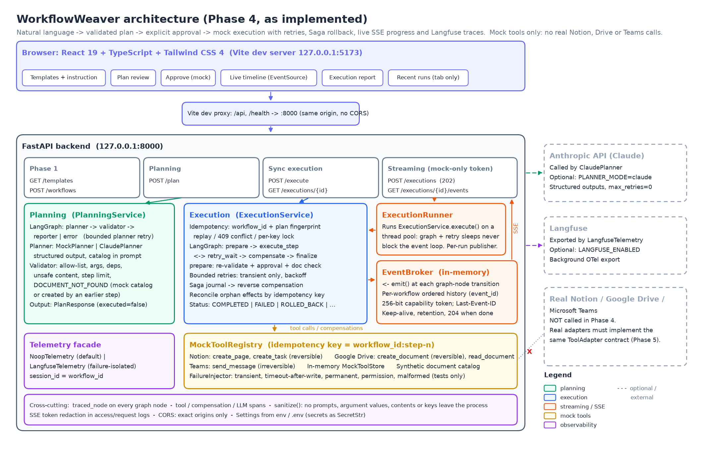
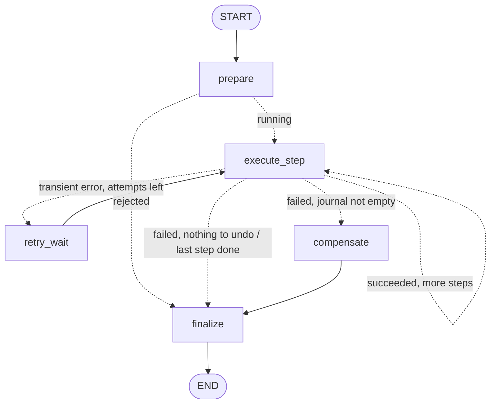

# WorkflowWeaver Architecture (Phase 4, as implemented)

WorkflowWeaver turns a natural-language instruction into a **validated plan**. The plan is only executed after **explicit approval**. In Phase 4, execution uses **mock** Notion, Google Drive and Teams adapters, with:

- bounded retries;
- idempotency;
- Saga compensation (rollback);
- live **Server-Sent Events** (SSE) progress;
- **Langfuse** observability;
- a **React + TypeScript + Tailwind** frontend.

No real Notion, Google Drive or Teams service is called anywhere in the codebase.



`architecture.png` is generated from [`diagrams/render_architecture.py`](diagrams/render_architecture.py) (see section 16). The LangGraph diagrams below are generated from the compiled graphs.

**Contents**

1. [Components](#1-components)
2. [Request flows](#2-request-flows)
3. [Planning graph](#3-planning-graph)
4. [Execution graph](#4-execution-graph)
5. [Tool adapters, idempotency and failure injection](#5-tool-adapters-idempotency-and-failure-injection)
6. [Live progress over SSE](#6-live-progress-over-sse)
7. [Observability (Langfuse)](#7-observability-langfuse)
8. [Frontend](#8-frontend)
9. [Validation layers](#9-validation-layers)
10. [Claude structured planning](#10-claude-structured-planning)
11. [Security boundaries](#11-security-boundaries)
12. [Worked example (real output)](#12-worked-example-real-output)
13. [Testing](#13-testing)
14. [Debugging in VS Code](#14-debugging-in-vs-code)
15. [Comparison with Java Spring Boot orchestration](#15-comparison-with-java-spring-boot-orchestration)
16. [Regenerating the diagrams](#16-regenerating-the-diagrams)
17. [Known limitations](#17-known-limitations)
18. [Phase 5 recommendations](#18-phase-5-recommendations)

---

## 1. Components

```
backend/app/
├── main.py                      FastAPI app: routers, restricted CORS, SSE-token log redaction, lifespan
├── core/
│   ├── config.py                Settings (env / .env, pydantic-settings); cors_origins()
│   └── log_redaction.py         Redacts access_token=... from uvicorn/httpx log records
├── api/
│   ├── workflows.py             Phase 1: GET /templates (+ example_instruction), POST /workflows
│   ├── planning.py              POST /plan            -> PlanningService
│   ├── execution.py             POST /execute, GET /executions/{id}   -> ExecutionService
│   └── streaming.py             POST /executions (202), GET /executions/{id}/events (SSE)
├── schemas/                     Pydantic contracts: workflow.py, plan.py, execution.py, events.py
├── agents/
│   ├── catalog.py               Allow-list: integration -> action -> required/optional args
│   ├── synthetic_documents.py   Synthetic Drive catalog (shared by planner, validator, adapter)
│   ├── validation.py            validate_draft() + document_availability_issues()
│   ├── state.py / nodes.py / graph.py / service.py      Planning LangGraph
│   ├── planners/                base (Planner protocol, PlannerError), mock, claude, factory
│   └── execution/
│       ├── state.py / nodes.py / graph.py / service.py  Execution LangGraph + idempotency store
│       ├── retry.py             RetryPolicy (bounded, capped exponential backoff, jitter)
│       └── tools/               ToolAdapter contract, mock adapters, MockToolRegistry, FailureInjector
├── streaming/
│   ├── broker.py                EventBroker / EventChannel (thread -> asyncio bridge, history)
│   ├── emitter.py               emit(): run-scoped ContextVar publisher used by graph nodes
│   └── runner.py                ExecutionRunner: bounded ThreadPoolExecutor
└── observability/
    ├── telemetry.py             Telemetry facade: NoopTelemetry | LangfuseTelemetry
    ├── nodes.py                 traced_node(): one observation per LangGraph node transition
    └── sanitize.py              Scrubber, also installed as the Langfuse SDK mask hook

backend/scripts/   trace_graph.py, langfuse_check.py, e2e_check.py
frontend/src/
├── api/                         types.ts (mirrors Pydantic), client.ts (fetch), stream.ts (EventSource)
├── state/                       execution.ts (event reducer), useExecution.ts, forms.ts (validation, request mapping)
└── components/                  Header, WorkflowInput, PlanReview, ApprovalPanel, ExecutionMonitor,
                                 ExecutionReport, SessionHistory, StatusBadge
```

**Dependency direction.** `api -> agents/streaming -> (planners, validation, tools) -> schemas`. Observability is a facade that every layer calls; it never calls back.

- Nothing under `agents/` imports FastAPI, so both graphs run unchanged from tests, scripts or a future worker.
- `app/streaming/__init__.py` deliberately imports nothing, because importing eagerly there would create an import cycle (nodes → emitter → runner → service → nodes).

## 2. Request flows

### 2.1 Planning: `POST /api/v1/workflows/plan`

```
PlanRequest (Pydantic, extra="forbid") ── invalid ─> 422 {"detail": ...}
  └─ PlanningService (built once: planner from PLANNER_MODE, synthetic catalog if MOCK_EXECUTION_ENABLED)
       └─ telemetry "planning.request" (root; session_id = workflow_id)
            └─ graph.invoke(initial_state)        planner -> validator -> reporter | error
  └─ PlanResponse   200 PLANNED | 422 INVALID | 502 FAILED   (503 if the planner is misconfigured)
```

### 2.2 Synchronous execution: `POST /api/v1/workflows/execute` (Phase 3 contract, unchanged)

```
ExecutionRequest {workflow_id, plan, approval{approved, mode:"mock", approved_by}}
  └─ ExecutionService.execute
       ├─ per-workflow_id lock; stored result? same plan -> replay (replayed=true) | different plan -> 409
       └─ telemetry "execution.request" -> graph.invoke -> ExecutionResponse (stored unless REJECTED)
  └─ 200 COMPLETED | 403/422 REJECTED | 502 FAILED/ROLLED_BACK/PARTIALLY_ROLLED_BACK/COMPENSATION_FAILED
```

The endpoint is a plain `def`, so FastAPI runs it in its thread pool. Retry sleeps happen inside that request thread.

### 2.3 Streamed execution: `POST /executions` + `GET /executions/{id}/events`

```
POST /executions  (same body)
  ├─ check_conflict (409) ; broker.create(workflow_id) (409 if a stream is active, 503 if full)
  ├─ ExecutionRunner.submit(worker thread):  set_publisher(channel) -> ExecutionService.execute(...)
  └─ 202 {stream_url (with access_token), stream_token, result_url}

worker thread:  graph nodes call emit(...) -> EventChannel.publish (lock, append, call_soon_threadsafe)
event loop:     GET /events?access_token=... -> subscribe(after Last-Event-ID) -> backlog + live queue -> SSE
```

The synchronous and streamed endpoints share one `ExecutionService`, so idempotency covers both.

## 3. Planning graph


Print the live graph with `python -m scripts.trace_graph --mermaid`.

- **planner**: calls the `Planner` (mock or Claude). A `PlannerError(retryable=True)` loops back to the planner, up to `MAX_PLANNING_ATTEMPTS`. Any other exception fails closed (`PLANNER_ERROR`).
- **validator**:
  - Runs `validate_draft` (allow-list, arguments, dependencies, step limit, unsafe content).
  - In mock execution mode, it also runs `document_availability_issues`. Every `read_document` name must exactly match a synthetic catalog document, or the title of an *earlier* `create_document` step. A miss is reported as a `DOCUMENT_NOT_FOUND` issue, with a "did you mean" hint for case-only differences.
- **reporter / error**: set the final status. `PlanResponse` returns only validated steps; a rejected draft is described by its issues.

**WorkflowState** (`agents/state.py`) is a `TypedDict`. Each node returns a *partial* dict, and LangGraph merges it in. `errors` uses the `operator.add` reducer, so a retried timeout stays visible after the retry succeeds. Routers are pure functions.

| Key | Written by | Meaning |
|---|---|---|
| `workflow_id`, `user_input`, `workflow_name`, `planner_name` | `initial_state` | Identity and input |
| `current_step`, `status` | every node | Last node; `pending → validating → valid → planned`, or `planning_failed` / `invalid` / `failed` |
| `planning_attempts`, `last_error_retryable` | planner | Drive the retry edge |
| `draft_plan`, `planned_steps`, `plan_summary` | planner, validator | Untrusted draft; replaced by validated, typed steps on success |
| `validation_issues`, `errors` (accumulates), `results` | validator, error, reporter | Outcome |

**Mock planner** (`planners/mock.py`). This is a deterministic keyword planner: it splits the instruction into clauses and maps each clause to a step.
- **Drive reads** use the document the instruction names: a quoted name, otherwise a catalog name mentioned verbatim, otherwise the phrase used. There is no fuzzy matching, so the planner can never read a different document than the one requested.
- **Titles** come from the workflow subject, e.g. `Action items: Synthetic standup notes`.

## 4. Execution graph



| Node | What it does | SSE events it emits |
|---|---|---|
| `prepare` | Re-validates the client-supplied plan (`validate_draft`, executor support, **document precheck**), then checks `approval.approved` | `workflow_started` (only if accepted) |
| `execute_step` | Exactly **one** tool attempt. On success: step result, plus a journal entry if the step had a side effect. On a transient error with attempts left: route to `retry_wait`. Otherwise: fail the step, skip the rest, and **reconcile** | `step_started`, `step_succeeded` / `step_failed` (`will_retry`, `retries_exhausted`) |
| `retry_wait` | Backoff `base·2^(n-1)`, capped, optional "equal jitter" in `[d/2, d]`. Sleeps through an injectable sleeper | `retry_scheduled` (`phase: execution`) |
| `compensate` | Walks the Saga journal **in reverse**. Each reversible effect is undone with its own bounded retries. Irreversible effects are reported, not undone. Every entry is attempted even if an earlier one fails | `compensation_started`, `compensation_completed` / `compensation_failed`, `retry_scheduled` (`phase: compensation`) |
| `finalize` | Computes the final status | `workflow_completed` / `workflow_failed` (always last) |

**Retries.** Only `transient` tool errors are retried, up to `EXECUTION_MAX_ATTEMPTS`. `permanent` and `permission` errors fail immediately. Retries are visible graph transitions (`execute_step → retry_wait → execute_step`), not hidden loops. The LangGraph `recursion_limit` is derived from step count × attempts.

**Reconcile.** If a step fails after its effect happened (timeout after the write, or a malformed response), `find_result(idempotency_key)` finds the effect and journals it, so it is still compensated.

**Final status.**

| Status | Meaning |
|---|---|
| `COMPLETED` | Every step succeeded |
| `FAILED` | A step failed before any side effect existed |
| `ROLLED_BACK` | Every journaled effect was undone |
| `PARTIALLY_ROLLED_BACK` | Reversible effects were undone; an irreversible one (a Teams message) remains |
| `COMPENSATION_FAILED` | At least one undo failed; manual review needed |
| `REJECTED` | Approval missing, or the plan failed re-validation; nothing executed |

**ExecutionState** (`execution/state.py`):
- Scalars are overwritten: `status`, `current_index`, `last_outcome`, `attempts`, `failed_step`, `final_status`.
- Lists accumulate with `operator.add`: `step_results`, `journal` (the Saga log), `errors`, `retry_delays`, `compensation_results`.

## 5. Tool adapters, idempotency and failure injection

`ToolAdapter` contract (`tools/base.py`), which every adapter must honour, real ones included:

- `effect_of(action)` returns `READ_ONLY | REVERSIBLE | IRREVERSIBLE`. This drives journaling and compensation.
- `execute(call)`: the idempotency key is `"{workflow_id}:step-{n}"`. Repeating a completed key returns the stored result with `replayed=True` and **no second effect**.
- `compensate(call)` is idempotent: undoing something already undone reports `ALREADY_COMPENSATED`.
- `find_result(key)` is used to reconcile unknown outcomes.

| Adapter (mock, in memory) | Actions | Effect |
|---|---|---|
| Notion | `create_page`, `create_task` | reversible |
| Google Drive | `create_document` | reversible |
| Google Drive | `read_document` (synthetic catalog, or a document created earlier) | read-only; `DOCUMENT_NOT_FOUND` otherwise |
| Teams | `send_message` | irreversible |

**Idempotency works at two levels:**
- **Request level**: `workflow_id` plus a plan fingerprint. A duplicate is replayed, a different plan gets 409, and concurrent duplicates are serialised by a per-key lock.
- **Tool level**: idempotency keys, so a run whose request store was lost (e.g. after a restart) still doesn't duplicate effects.

**Failure injection** (`FailureInjector`) supports `transient`, `transient_after_effect`, `permanent`, `permission_denied` and `malformed_result`, consumed per attempt and per step. It can only be configured **in code**: the API never accepts it, and `create_tool_registry` refuses it when `APP_ENV=production`.

## 6. Live progress over SSE

**Event contract** (`schemas/events.py`): `ExecutionEvent{event_id, workflow_id, event_type, step_number, timestamp, metadata}`.
- `event_id` runs 1..N per workflow and is also the SSE `id`.
- Wire format: `id: N` / `event: <type>` / `data: <json>`.
- The ten event types are listed in section 4.

**How events are tied to graph nodes.**
- The nodes call `emit(...)` at the actual transitions.
- `emit` looks up a publisher held in a `ContextVar`, which `ExecutionRunner` sets **only in the worker thread running that request**. LangGraph propagates context variables into node execution.
- So events come from real transitions, are never reconstructed from the result, and cannot leak into another workflow's stream. The synchronous `/execute` endpoint has no publisher, so it emits nothing.

**Transport** (`streaming/broker.py`).
- `publish` appends under a `threading.Lock` and hands the event to each subscriber's `asyncio.Queue` with `loop.call_soon_threadsafe`. Publishing is serialised per channel and those callbacks run FIFO, so **ordering** is preserved.
- `subscribe` takes the backlog snapshot and registers the queue under the same lock, so a subscriber never sees a gap or a duplicate.
- The SSE handler keeps **one pending `queue.get()` across keep-alives** and never cancels it on a heartbeat timeout. (On Python < 3.12, cancelling a `get()` that has just received an item can drop that item.)
- Every unsubscribe is logged with its reason: `terminal`, `client_disconnected`, `cancelled` or `closed`.

**Reconnection and lifecycle.**
- `retry: 3000`; `EventSource` resends `Last-Event-ID`, and the server replays everything after it.
- Once the stream has finished and the client already has every event, the server returns `204`, which stops `EventSource` from reconnecting.
- A disconnect doesn't stop the run; its result stays at `result_url`.
- Finished channels are evicted after `SSE_RETENTION_SECONDS`. History is capped at 2,000 events, and the terminal event is always kept.

**Event loop never blocked.** Graph execution and retry sleeps run on a bounded `ThreadPoolExecutor` (`EXECUTION_WORKER_THREADS`). The end-to-end suite holds a run inside its retry wait and checks that `retry_scheduled` has already reached the client, the result is still 404, and `/health` answers immediately.

## 7. Observability (Langfuse)

`observability/telemetry.py` exposes `get_telemetry().observe(...)` and `.event(...)`.
- **Default: `NoopTelemetry`.** It is also the fallback whenever `LANGFUSE_ENABLED=true` but the keys are missing or the client fails to construct.
- **`LangfuseTelemetry`** wraps `langfuse.Langfuse` (SDK v5.1.0, OpenTelemetry-based). It uses the SDK's `start_as_current_observation`, `update`, `create_event`, `propagate_attributes`, `flush` and `shutdown` calls.

| Observation | Type | Source |
|---|---|---|
| `planning.request` / `execution.request` | agent, trace root; `session_id = workflow_id` | services |
| `planning.<node>` / `execution.<node>` | chain, with `step_number` | `traced_node` wraps **every** node in both graphs and records a *summary* of the node's state update |
| `claude.messages.parse` | generation: model, `max_tokens`, `usage_details` (only the token fields the API returned), stop reason | `ClaudePlanner` |
| `tool.<integration>.<action>` / `compensation.<…>` | tool, one per attempt | execution nodes |
| `execution.retry_scheduled`, `execution.compensation_retry_scheduled`, `execution.effect_reconciled`, `execution.outcome` | event | execution nodes / service |

- **Failure isolation.** Every SDK call is wrapped. A failure at start, update, end, event, flush, shutdown or attribute propagation is logged once (exception type only) and counted, and the workflow carries on with an identical result. Exceptions raised *by the workflow* are recorded on the span (error code only) and re-raised unchanged.
- **Sanitisation.** Callers send only identifiers, codes, counts, argument *names*, lengths and timings. `sanitize()` scrubs anything else: secret-named keys, content keys, `sk-ant-`/`sk-lf-`/bearer/JWT/webhook patterns, and size limits. It is also installed as the SDK's `mask` hook.
- **Verification.** `scripts.langfuse_check` checks the credentials with `auth_check()` and runs one planning request and one execution (with a retry and a rollback).
- **Tests.** Tests pin telemetry to a no-op. They exercise the real SDK against an in-memory OpenTelemetry exporter, so nothing touches the network.

## 8. Frontend

Built with React 19, TypeScript 7, Vite 8, Tailwind CSS 4 and Vitest 5 (jsdom 29.1.1, pinned for Node 22.14).

- **Contracts.** `src/api/types.ts` mirrors the Pydantic models field for field. Template instructions come from the backend (`example_instruction`), so there is one source of truth, and backend tests verify that each one plans and executes.
- **State comes only from events.** `state/execution.ts` is a reducer over `ExecutionEvent`s. It ignores events from other workflows, duplicates, out-of-order events, and anything after the terminal event. Step badges: pending, running, succeeded, failed, retrying, compensating, rolled back, not reversible, compensation failed, skipped.
- **Connection states.**
  - connecting → live;
  - reconnecting, where the browser retries automatically with `Last-Event-ID`;
  - disconnected, with a manual **Reconnect** (resumes via `last_event_id`) and **Check final result**;
  - stream complete.
- **Report.** The report comes from `GET result_url`. A `REJECTED` run has no stored report, so the UI shows the terminal event's status and codes instead.
- **Connectivity.** The Vite dev proxy forwards `/api` and `/health`, so the browser stays same-origin and needs no CORS. If `VITE_API_BASE_URL` points at the backend directly, `CORS_ALLOW_ORIGINS` applies: exact origins, GET/POST, `Content-Type`/`Last-Event-ID`/`X-Stream-Token`, no credentials. `*` is rejected. The default in development is only the two Vite origins.
- **Secrets.** The bundle contains no Anthropic or Langfuse keys or variable names; the build output is checked. `VITE_*` variables are public by design.

## 9. Validation layers

| Layer | Where | What it guarantees |
|---|---|---|
| 1. Request | `PlanRequest`, `ExecutionRequest` (`extra="forbid"`) | Lengths, types, `approval.mode == "mock"`, no unknown fields (so fault injection can't be smuggled in) |
| 2. LLM output shape | `DraftPlan` via `messages.parse` | Correct JSON structure |
| 3. Business rules | `validate_draft` | Allowed integration/action/arguments, sequential steps, dependencies only on earlier steps, step limit, no code/shell content |
| 4. Mock document availability | `document_availability_issues` (planning **and** execution `prepare`) | Reads target an existing synthetic document or one created earlier in the plan |
| 5. Executor support + approval | `prepare` node | A mock adapter exists for every step; `approved == true` |
| 6. Tool argument re-check | mock adapters | Required/unknown arguments checked again at call time |
| 7. Runtime existence | Drive adapter | `DOCUMENT_NOT_FOUND` (permanent). Exercised with `document_precheck=False` |

All validation issues are collected, not fail-fast, so a response lists every problem at once.

## 10. Claude structured planning

```python
client.messages.parse(
    model=settings.anthropic_model,                       # ANTHROPIC_MODEL; never hardcoded
    max_tokens=settings.anthropic_max_tokens,
    system=build_system_prompt(max_steps, available_documents),
    messages=[{"role": "user", "content": "<instruction>...</instruction>"}],
    output_format=DraftPlan,
)
```

- The system prompt is generated from `catalog.py`, the same allow-list the validator enforces.
- In mock execution mode it also lists the synthetic document **names** (never contents). Claude is told to use exact names and never to substitute a different document.
- `integration` and `action` are free strings, so an unsupported request ("Jira") reaches the validator and is reported, instead of being silently mapped to an allowed tool.
- The client uses `max_retries=0`; the graph's retry edge owns retries.

| Failure | Code | Retryable |
|---|---|---|
| `APITimeoutError` / `APIConnectionError` | `PLANNER_TIMEOUT` / `PLANNER_CONNECTION_ERROR` | yes |
| 429 / ≥ 500 | `PLANNER_RATE_LIMITED` / `PLANNER_API_ERROR` | yes |
| Auth / permission | `PLANNER_AUTH_ERROR` | no |
| Bad request / unknown model | `PLANNER_REQUEST_REJECTED` | no |
| Schema mismatch, no parsed output, `max_tokens` | `INVALID_LLM_OUTPUT` | yes |
| `stop_reason == "refusal"` | `PLANNER_REFUSED` | no |

## 11. Security boundaries

| Boundary | Mechanism |
|---|---|
| No real side effects | Only in-memory mock adapters exist; `approval.mode` must be `"mock"`; Notion/Drive/Teams credentials are never read |
| Plans are untrusted | Re-validated at execution time (layers 3–5); actions dispatch through a typed registry, never through LLM strings |
| Explicit approval | `approval.approved` must be true (403 otherwise); `approved_by` is a label, not authentication |
| Stream access | Unguessable 256-bit per-workflow token, compared in constant time; wrong and unknown are indistinguishable (404); streaming disabled when `APP_ENV=production` |
| Tokens out of logs | `log_redaction.py` rewrites `access_token=` in uvicorn access and httpx request logs |
| Failure injection | Code-only; refused in production |
| Secrets | `ANTHROPIC_API_KEY` read by the SDK only; `LANGFUSE_SECRET_KEY` is a `SecretStr`; none reach logs, telemetry, events or the browser |
| Telemetry content | No prompts, argument values, contents or messages leave the process; the sanitiser is the backstop |
| Browser access | Same-origin proxy; optional CORS restricted to exact origins, no credentials |

The `GET /executions/{workflow_id}` result endpoint keeps its Phase 3 behaviour: no token, lookup by unguessable UUID.

## 12. Worked example (real output)

Meeting-to-Tasks `example_instruction`: *"Read 'Synthetic standup notes' from Google Drive, create Notion tasks for each action item, save the meeting minutes to Google Drive, and notify attendees in Microsoft Teams."*

**Plan** (`PLANNED`, mock planner):

```json
[{"step_number": 1, "integration": "google_drive", "action": "read_document",
  "arguments": {"document_name": "Synthetic standup notes"}, "depends_on": []},
 {"step_number": 2, "integration": "notion", "action": "create_task",
  "arguments": {"title": "Action items: Synthetic standup notes"}, "depends_on": [1]},
 {"step_number": 3, "integration": "google_drive", "action": "create_document",
  "arguments": {"title": "Synthetic standup notes: summary", "content": "Summary of: ..."}, "depends_on": [1]},
 {"step_number": 4, "integration": "teams", "action": "send_message",
  "arguments": {"message": "'Synthetic standup notes' workflow is ready for review."}, "depends_on": [1, 2, 3]}]
```

**Streamed execution with one injected transient failure on step 2:**

```
 1 workflow_started      -     {"step_count": 4, "max_attempts": 3, "steps": [...]}
 2 step_started          1     {"attempt": 1, "integration": "google_drive", "action": "read_document"}
 3 step_succeeded        1     {"attempt": 1, "resource_id": "mock-gdrive-fixture-47ab4ddac697", "replayed": false}
 4 step_started          2     {"attempt": 1, "integration": "notion", "action": "create_task"}
 5 step_failed           2     {"attempt": 1, "error_code": "TOOL_TIMEOUT", "error_kind": "transient", "retryable": true,
                                "will_retry": true, "retries_exhausted": false}
 6 retry_scheduled       2     {"phase": "execution", "failed_attempt": 1, "next_attempt": 2, "max_attempts": 3,
                                "delay_seconds": 0.2, "error_code": "TOOL_TIMEOUT"}
 7 step_started          2     {"attempt": 2, ...}
 8 step_succeeded        2     {"attempt": 2, "resource_id": "mock-notion-task-50438ee98881", "replayed": false}
 9-12 steps 3 and 4 started/succeeded
13 workflow_completed    -     {"status": "COMPLETED", "attempts": {"1": 1, "2": 2, "3": 1, "4": 1}, ...}
```

Final `ExecutionResponse`: `COMPLETED`, `attempts {"1":1,"2":2,"3":1,"4":1}`, `retry_delays_seconds [0.2]`.

**Rollback variant** (permanent failure on step 4): `step_failed(4, will_retry=false)` → `compensation_started/completed(3)` → `compensation_started/completed(2)` → `workflow_failed {status: ROLLED_BACK}`. Step 1 is a read, so it isn't journaled.

**Missing document**: *"Read the synthetic Sprint 42 meeting notes from Google Drive, …"*
- `/plan` returns 422 `INVALID` with `DOCUMENT_NOT_FOUND`. The message lists the available synthetic documents.
- Forcing the plan through `/executions` produces a single `workflow_failed {status: REJECTED, validation_issue_codes: ["DOCUMENT_NOT_FOUND"]}` without calling any tool.

## 13. Testing

| Suite | Count | What it covers |
|---|---|---|
| Backend `pytest` | **294** | See the per-file table below |
| Live end-to-end (`scripts.e2e_check`, also in pytest) | 11 scenarios | Real uvicorn server, HTTP + SSE: 3 templates, retry with live delivery, idempotent retry, retry exhaustion, reverse rollback, partial rollback, compensation failure, duplicate replay, `DOCUMENT_NOT_FOUND` |
| Frontend `vitest` | **31** | Reducer, API client, EventSource wrapper, App flows (templates, validation, plan review, approval request body, live badges, reconnect/disconnect, rejected runs, API failures) |

Backend per file:

| File | Tests | File | Tests |
|---|---|---|---|
| test_workflows | 11 | test_execution_api | 14 |
| test_planning_api | 9 | test_observability | 56 |
| test_planning_graph | 13 | test_sse | 39 |
| test_plan_validation | 24 | test_cors | 7 |
| test_claude_planner | 18 | test_template_execution | 20 |
| test_execution_tools | 16 | test_planner_catalog_and_titles | 16 |
| test_execution_graph | 36 | test_e2e_live | 11 |
| test_log_redaction | 4 | | |

The tests never make network calls outside `127.0.0.1`. The Claude planner is tested with a fake client, and `ANTHROPIC_API_KEY` is removed from the environment for each test. The live-server, SSE and redaction tests passed 24 of 24 runs with 3 copies running in parallel.

## 14. Debugging in VS Code

1. Install the **Python** and **Python Debugger** extensions, then select `backend\.venv\Scripts\python.exe` as the interpreter.
2. `.vscode/launch.json` provides:
   - **FastAPI (uvicorn, mock planner)**: runs without `--reload`, so breakpoints bind.
   - **Trace planning graph**: `scripts/trace_graph.py`.
   - **Pytest (current file)**.
3. Useful breakpoints:
   - planning: the start and `return` of each node in `agents/nodes.py`, and the routers;
   - execution: `ExecutionNodes.execute_step_node`, `_compensate_one` and `finalize_node` in `agents/execution/nodes.py`;
   - streaming: `EventChannel.publish` and the `event_stream` loop.
4. Without a debugger: `graph.stream(state, stream_mode="updates")` yields `{node: update}` after each node. Set `LOG_LEVEL=DEBUG` for more output.

## 15. Comparison with Java Spring Boot orchestration

| Concept here | Spring Boot analogue |
|---|---|
| FastAPI router + Pydantic request model | `@RestController` + `@RequestBody @Valid` DTO |
| `Depends(...)` + `dependency_overrides` | Constructor injection; `@MockBean` in tests |
| `Settings` (pydantic-settings) | `@ConfigurationProperties` |
| `StateGraph` + conditional edges | Spring State Machine guards / Spring Batch `JobExecutionDecider` |
| Graph state with reducers | `ExecutionContext`, with explicit, typed merging |
| `RetryPolicy` + `retry_wait` node | Spring Retry / Resilience4j `Retry`, but as a visible graph edge |
| Saga journal + `compensate` node | Orchestrated Saga (e.g. Axon / Eventuate Tram compensating transactions) |
| Idempotency key per tool call | Idempotent consumer / `Idempotency-Key` header pattern |
| `EventBroker` + SSE | `SseEmitter` / WebFlux `Flux<ServerSentEvent>` |
| `ThreadPoolExecutor` runner | `@Async` with a `ThreadPoolTaskExecutor` |
| Telemetry facade + Langfuse | Micrometer Tracing / OpenTelemetry with a custom exporter |
| `Planner` protocol (mock vs Claude) | Interface with `@ConditionalOnProperty` implementations |

The main difference from typical Spring workflows: an LLM proposes the workflow at runtime, so the plan is treated as untrusted input and validated again before every execution.

## 16. Regenerating the diagrams

- **`docs/architecture.png`**: `docs/diagrams/render_architecture.py` needs only `matplotlib==3.11.2`. Use a throwaway venv, and don't add matplotlib to the backend requirements:

  ```powershell
  cd C:\Projects\workflowweaver
  py -3.11 -m venv .docvenv
  .\.docvenv\Scripts\python.exe -m pip install matplotlib==3.11.2
  .\.docvenv\Scripts\python.exe docs\diagrams\render_architecture.py
  ```

  `.docvenv/` is git-ignored.
- **Graph diagrams**: `python -m scripts.trace_graph --mermaid` (planning). For the execution graph, call `build_execution_graph(...).get_graph().draw_mermaid()`.

## 17. Known limitations

- **Mock only.** No real Notion, Google Drive or Teams adapter exists. The document precheck assumes the fixed mock catalog; a real Drive needs a lookup at execution time. Documents created by *previous* runs can't be read in mock mode.
- **In-memory, single process.** The idempotency store, results, SSE channels and the mock "outside world" are lost on restart, and don't work across uvicorn workers or instances. Memory grows with runs (SSE channels expire; results do not).
- **Access model.** The stream token is a capability, not user authentication, and it travels in the URL. Any reverse proxy also needs log redaction. `approved_by` is an unverified label. The result endpoint has no token.
- **Execution model.** Steps run sequentially even when independent. In the synchronous endpoint, retry waits block a worker thread. When all workers are busy, streamed runs queue silently.
- **Planning.** The mock planner is keyword-based: it splits clauses on "and", so subjects can be cut short. The Claude path is tested only with a fake client. Validation errors aren't fed back to the planner for self-correction.
- **Failures can't be demoed from the UI.** Fault injection is test-only; scenarios are covered by `scripts.e2e_check`.
- **Not run in this environment.** A real Langfuse project (use `scripts.langfuse_check`), a real Claude API key, and browser-level end-to-end tests. The frontend was checked manually and through jsdom tests.

## 18. Phase 5 recommendations

1. **Real adapters.** Implement Notion MCP, Google Drive MCP and a Teams webhook behind the existing `ToolAdapter` contract. Make idempotency durable (store key → resource id, or use the API's own idempotency support). Implement `find_result` for reconciliation. Replace the static document precheck with a live lookup.
2. **Persistence.** Store plans, runs, the idempotency store and SSE event history (Postgres, or Redis Streams for events). Add a LangGraph checkpointer so runs survive restarts and can pause for approval (`interrupt()`).
3. **Authentication and authorization.** Use OIDC users and per-user authorization on workflows. Move the stream token from the URL to a cookie or header. Protect the result endpoint. Add an audit log of approvals.
4. **Scale-out.** Use a shared broker (Redis pub/sub or Streams) so SSE works across workers. Move execution to a worker queue. Run independent steps in parallel.
5. **Planner quality.** Feed validation issues back to Claude for self-correction, add an evaluation dataset, and track planner quality as Langfuse scores.
6. **Operations.** Add CI running both suites plus `e2e_check`, browser end-to-end tests (Playwright), a container image, and a development-only, clearly labelled failure-demo mode.
