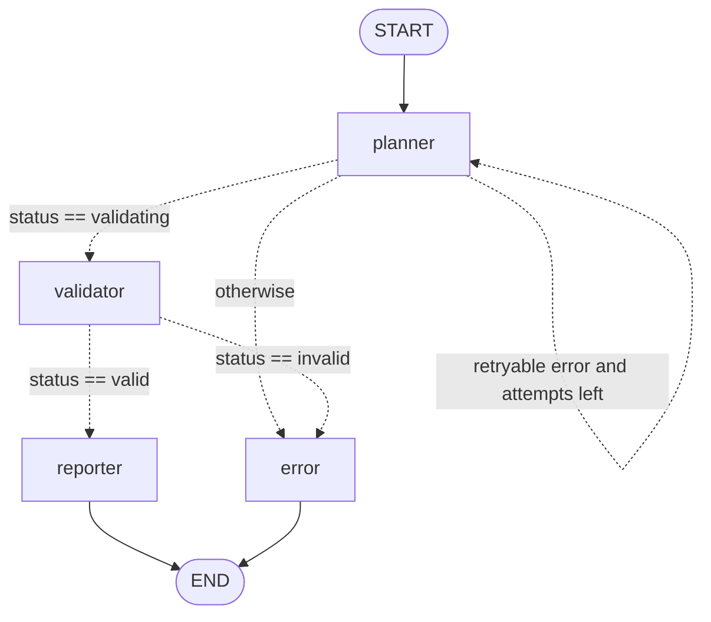

# WorkflowWeaver Architecture (Phase 2)

Phase 2 adds a **stateful LangGraph planning agent**. It converts a natural-language instruction into a structured, validated execution plan. It does **not** execute anything.

## 1. Components

```
backend/app/
├── main.py                  FastAPI app; registers Phase 1 + Phase 2 routers
├── core/config.py           Settings (env vars / .env) via pydantic-settings
├── api/
│   ├── workflows.py         Phase 1 routes (unchanged)
│   └── planning.py          POST /api/v1/workflows/plan  -> PlanningService
├── schemas/
│   ├── workflow.py          Phase 1 models + Integration enum (reused)
│   └── plan.py              DraftPlan (untrusted) / WorkflowPlan (validated), API models
└── agents/
    ├── catalog.py           Allow-list: integration -> action -> required/optional args
    ├── state.py             WorkflowState (TypedDict) shared by all nodes
    ├── validation.py        Pure validation rules (allow-list, args, deps, unsafe content)
    ├── nodes.py             planner / validator / reporter / error nodes + routers
    ├── graph.py             StateGraph wiring, initial_state(), recursion limit
    ├── service.py           Runs the compiled graph, maps final state -> PlanResponse
    └── planners/
        ├── base.py          Planner protocol, PlannerError(retryable), PlannerConfigError
        ├── mock.py          Deterministic keyword planner (no network)
        ├── claude.py        Claude planner (Anthropic SDK structured outputs)
        └── factory.py       Chooses planner from PLANNER_MODE
```

Dependency direction is one-way: `api -> agents.service -> agents.graph -> agents.nodes -> (planners, validation) -> schemas`. Nothing in `agents/` imports FastAPI, so the graph can be run from a script, a test, or a future worker queue.

## 2. Request flow: how FastAPI invokes LangGraph

```
HTTP POST /api/v1/workflows/plan  {"instruction": "...", "name": "..."}
  │
  ├─ FastAPI validates body against PlanRequest (Pydantic)  ── fail ─> 422 {"detail": ...}
  │
  ├─ Depends(get_planning_service)
  │     └─ _default_service()  (lru_cache: built once per process)
  │           ├─ get_settings()            reads env / .env
  │           ├─ create_planner(settings)  MockPlanner | ClaudePlanner ── config error ─> 503
  │           └─ build_planning_graph(planner).compile()
  │
  ├─ service.plan(instruction)
  │     ├─ initial_state(...)              new workflow_id (uuid4)
  │     └─ graph.invoke(state, config={"recursion_limit": N})   ← synchronous LangGraph run
  │
  └─ to_response(final_state) -> PlanResponse -> JSONResponse(200 | 422 | 502)
```

The endpoint is a plain `def`, so FastAPI runs it in its thread pool and the blocking `graph.invoke` (and the blocking Anthropic call inside it) does not stall the event loop. Tests replace the service with `app.dependency_overrides[get_planning_service]`, the FastAPI equivalent of injecting a mock bean.

## 3. Graph



Generate the live diagram with `python -m scripts.trace_graph --mermaid`.

The required flow `START -> planner -> validator -> reporter|error -> END` is preserved. The only addition is the planner self-loop, which is how planning retries are bounded (`MAX_PLANNING_ATTEMPTS`). LangGraph's `recursion_limit` (attempts + 5) is a second safety net against runaway loops.

## 4. WorkflowState

`WorkflowState` (`agents/state.py`) is a `TypedDict`: a plain dict with declared keys and types. It is the only thing passed between nodes.

| Key | Written by | Meaning |
|---|---|---|
| `workflow_id`, `user_input`, `workflow_name`, `planner_name` | `initial_state` | Identity and input; never changed |
| `current_step` | every node | Name of the node that last ran |
| `status` | every node | `pending → validating → valid → planned`, or `planning_failed` / `invalid` / `failed` |
| `planning_attempts`, `last_error_retryable` | planner | Drive the retry edge |
| `draft_plan` | planner | Raw planner output (untrusted) |
| `planned_steps` | planner, then validator | Draft steps; replaced by typed, validated steps on success |
| `plan_summary` | planner, validator | One-line summary |
| `validation_issues` | validator | List of `ValidationIssue` dicts |
| `errors` | planner, error | **Accumulates** (reducer `operator.add`) |
| `results` | reporter, error | Final outcome; always `execution: not_executed` |
| `max_steps`, `max_planning_attempts`, `metadata` | `initial_state` | Limits copied from settings |

### How nodes receive and update state

- A node is a function `(state) -> dict`. It receives the **whole** current state.
- It returns a **partial** dict containing only the keys it changes.
- LangGraph merges the partial update into the state. For most keys the new value **replaces** the old one. For `errors`, declared as `Annotated[list, operator.add]`, the new list is **appended** (`old + new`). That is why a retried timeout is still visible in the final response even when the second attempt succeeds.
- Nodes never mutate the state they received; they return new values.
- State values are JSON-serialisable dicts (`model_dump()`), not Pydantic objects, so the state can be checkpointed or streamed over SSE in Phase 3 without custom serialisers.

### How conditional edges route execution

`add_conditional_edges("planner", route_after_planner, {...})` tells LangGraph: after `planner` runs and its update is merged, call `route_after_planner(state)`; it returns a key from the mapping, which names the next node. Routers are pure functions: they read state and never write it, so they are trivially unit tested (`test_route_after_planner`).

## 5. Claude structured planning

`ClaudePlanner.plan()` calls:

```python
client.messages.parse(
    model=settings.anthropic_model,          # from ANTHROPIC_MODEL, never hardcoded
    max_tokens=settings.anthropic_max_tokens,
    system=build_system_prompt(max_steps),   # catalog + rules, generated from catalog.py
    messages=[{"role": "user", "content": "<instruction>...</instruction>"}],
    output_format=DraftPlan,                 # Pydantic model -> JSON schema constraint
)
```

1. The SDK converts `DraftPlan` into a JSON schema and sends it as the structured-output format. Claude's reply is constrained to that schema.
2. The SDK parses the reply back into a `DraftPlan` instance (`response.parsed_output`).
3. The system prompt is generated from `catalog.py`, the same allow-list the validator enforces, so prompt and validator cannot drift.
4. The instruction is wrapped in `<instruction>` tags and the prompt tells Claude to treat it as data. That reduces, but does not eliminate, prompt injection; the validator is the actual enforcement.

`DraftStep.integration` and `.action` are plain strings, deliberately not enums. If they were enums, the schema would force Claude to pick an allowed tool even when the user asked for Slack, silently substituting a different tool. As strings, an unsupported request reaches the validator and is reported as `UNSUPPORTED_INTEGRATION`.

`arguments` is a list of `{name, value}` pairs rather than a free-form dict, because a fixed-shape list is reliably expressible in a strict JSON schema.

### Failure handling

The SDK client is created with `max_retries=0` and `timeout=PLANNER_TIMEOUT_SECONDS`, so **one** place owns retry policy: the graph's retry edge. Every SDK failure becomes a `PlannerError(code, message, retryable)`:

| Failure | Code | Retryable |
|---|---|---|
| `APITimeoutError` | `PLANNER_TIMEOUT` | yes |
| `APIConnectionError` | `PLANNER_CONNECTION_ERROR` | yes |
| `RateLimitError` (429) | `PLANNER_RATE_LIMITED` | yes |
| `APIStatusError` ≥ 500 | `PLANNER_API_ERROR` | yes |
| `AuthenticationError` / `PermissionDeniedError` | `PLANNER_AUTH_ERROR` | no |
| `BadRequestError` / `NotFoundError` (bad model id) | `PLANNER_REQUEST_REJECTED` | no |
| Schema mismatch / JSON error / no parsed output / `max_tokens` | `INVALID_LLM_OUTPUT` | yes |
| `stop_reason == "refusal"` | `PLANNER_REFUSED` | no |
| Any other exception in a planner | `PLANNER_ERROR` (in node) | no |

Exception order matters: `APITimeoutError` is a subclass of `APIConnectionError`, so it is caught first.

## 6. Validation layers (Pydantic and beyond)

| Layer | Where | What it guarantees |
|---|---|---|
| 1. Request | `PlanRequest` | `instruction` 10–5000 chars, no unknown fields (`extra="forbid"`), whitespace stripped |
| 2. LLM output shape | `DraftPlan` via `messages.parse` | Correct JSON structure and types |
| 3. Business rules | `validation.validate_draft` | Allowed integration/action, required/unknown/duplicate args, arg length, sequential step numbers, dependencies only on earlier steps (no cycles), step limit, no code/shell content |
| 4. Typed result | `WorkflowPlan` / `WorkflowStep` | Integration and Action are enums; `arguments` is `dict[str, str]` |
| 5. Response | `PlanResponse` | Stable API contract; `executed` is always `false` |

All issues are collected (not fail-fast), so one response lists every problem in the plan.

## 7. Worked example (real output, mock planner)

Instruction: *"Read meeting notes, create a Notion project page, save a summary to Google Drive, and notify the team in Microsoft Teams."*

**Initial state** (`initial_state`):
```json
{"workflow_id": "00000000-...0001", "current_step": "start", "status": "pending",
 "planning_attempts": 0, "draft_plan": null, "planned_steps": [], "validation_issues": [],
 "errors": [], "results": {}, "max_steps": 10, "max_planning_attempts": 2}
```

**After `planner`**: changed `current_step, status, planning_attempts, last_error_retryable, draft_plan, planned_steps, plan_summary`
```json
{"current_step": "planner", "status": "validating", "planning_attempts": 1,
 "draft_plan": {"summary": "Planned 3 step(s) using: notion, google_drive, teams.",
   "steps": [
     {"step_number": 1, "integration": "notion", "action": "create_page",
      "arguments": [{"name": "title", "value": "Read meeting notes - Project page"},
                    {"name": "content", "value": "Project page generated from instruction: ..."}],
      "depends_on": []},
     {"step_number": 2, "integration": "google_drive", "action": "create_document", "depends_on": []},
     {"step_number": 3, "integration": "teams", "action": "send_message", "depends_on": [1, 2]}]}}
```
Router: `status == "validating"` → `validator`. ("Read meeting notes" is input context, not a tool step.)

**After `validator`**: changed `current_step, status, validation_issues, planned_steps, plan_summary`
```json
{"current_step": "validator", "status": "valid", "validation_issues": [],
 "planned_steps": [
   {"step_number": 1, "integration": "notion", "action": "create_page",
    "arguments": {"title": "Read meeting notes - Project page", "content": "..."}, "depends_on": []},
   {"step_number": 2, "integration": "google_drive", "action": "create_document", "...": "..."},
   {"step_number": 3, "integration": "teams", "action": "send_message",
    "arguments": {"message": "'Read meeting notes' workflow is ready for review."}, "depends_on": [1, 2]}]}
```
Arguments became a dict and integration/action were checked against the enums. Router: `status == "valid"` → `reporter`.

**After `reporter`**: changed `current_step, status, results`
```json
{"current_step": "reporter", "status": "planned",
 "results": {"step_count": 3, "integrations": ["google_drive", "notion", "teams"],
             "execution": "not_executed",
             "message": "Plan validated. Nothing was executed (Phase 2 plans only)."}}
```
→ `END`. The API returns HTTP 200 with `status: PLANNED`.

**Failure path**: *"Create a Jira issue and notify the team in Teams"*: planner drafts `jira.create_issue` + `teams.send_message`; validator sets `status: invalid` with `UNSUPPORTED_INTEGRATION` on step 1; router → `error`; error node sets `status: invalid` and appends `PLAN_VALIDATION_FAILED` to `errors`; API returns 422 with `planned_steps: []`.

**Retry path**: planner raises `PLANNER_TIMEOUT` (retryable) → `status: planning_failed`, attempts 1 → router → `planner` again → succeeds → validator → reporter. Final `errors` still contains the recovered timeout because of the `operator.add` reducer.

## 8. Debugging in VS Code

1. Install the **Python** and **Python Debugger** extensions; open `C:\Projects\workflowweaver`.
2. `Ctrl+Shift+P` → *Python: Select Interpreter* → `backend\.venv\Scripts\python.exe`.
3. `.vscode/launch.json` provides three configurations (Run and Debug panel, `Ctrl+Shift+D`):
   - **FastAPI (uvicorn, mock planner)**: runs without `--reload` (the reloader spawns a child process, so breakpoints would not bind). Set breakpoints in `nodes.py`, then call the endpoint from Swagger UI.
   - **Trace planning graph**: runs `scripts/trace_graph.py`, no server needed.
   - **Pytest (current file)**: debug the open test file; `justMyCode: false` lets you step into LangGraph.
4. Useful breakpoints: start of `PlanningNodes.planner_node` (inspect incoming `state`), the `return` of each node (inspect the partial update), and `route_after_planner` / `route_after_validator` (see which edge is taken).
5. Without a debugger: `graph.stream(state, stream_mode="updates")` yields `{node: update}` after each node (what the trace script prints); `stream_mode="values"` yields the full merged state after each step. Set `LOG_LEVEL=DEBUG` for more log output.

## 9. Comparison with Java Spring Boot orchestration

| Concept here | Spring Boot analogue |
|---|---|
| FastAPI router + `PlanRequest` | `@RestController` + `@RequestBody @Valid` DTO (Bean Validation) |
| `Depends(get_planning_service)` + `dependency_overrides` | Constructor injection of a `@Service`; `@MockBean` in tests |
| `Settings` (pydantic-settings) | `@ConfigurationProperties` bound from `application.yml` / env |
| `StateGraph` + nodes + conditional edges | Spring State Machine (states, transitions, guards), or a Spring Batch `Job` with `JobExecutionDecider` |
| `WorkflowState` | `ExtendedState` / `ExecutionContext`, a shared map passed between steps |
| Node returns partial update; reducers merge | Step writes to `ExecutionContext`; LangGraph makes merging explicit and typed |
| Router function | Guard / `JobExecutionDecider` returning a `FlowExecutionStatus` |
| Planner retry edge + `MAX_PLANNING_ATTEMPTS` | `@Retryable(maxAttempts=…)` / Resilience4j `Retry`, but modelled as a visible graph edge |
| `PlannerError(retryable)` | Retryable vs non-retryable exception classifiers in Spring Retry |
| `Planner` protocol, mock vs Claude | Interface with two `@Component` impls selected by `@ConditionalOnProperty` |
| `recursion_limit` | Max-transitions / step-execution limits |
| `HTTPException(503)` / `JSONResponse(status_code=…)` | `ResponseStatusException` / `ResponseEntity.status(...)` |

The main difference: Spring workflows are typically defined ahead of time by developers. Here an LLM proposes the workflow at runtime, so validation must treat the plan as untrusted input, the way a Spring app treats a request body.

## 10. Known limitations (Phase 2)

- The live Claude path is covered by tests with a fake client only. It has not been run against the real API in this repo, because tests must not make API calls and no key is configured.
- The mock planner is keyword-based: it does not understand negation or complex phrasing.
- Unsafe-content detection is a regex deny-list. It is a defence-in-depth layer, not a sandbox. The real guarantee is that Phase 2 has no executor and Phase 3 must call only typed, allow-listed actions.
- Plans are not persisted; `workflow_id` is not stored, and Phase 1 workflows and Phase 2 plans are not linked.
- `planning_attempts` retries the same prompt; it does not feed validation errors back to Claude for self-correction.
- Planning is synchronous (one HTTP request blocks until the graph finishes); there is no SSE progress yet.
- No server-side model fallback on refusals; a refusal returns `PLANNER_REFUSED`.

## 11. Phase 3 recommendations

1. **Executor graph**: add `executor` nodes after `reporter`, gated by an explicit human approval (`interrupt()` in LangGraph). Each action maps to a typed adapter (`NotionClient.create_page(title, content)`), never to dynamic dispatch on LLM strings.
2. **Persistence and checkpoints**: store plans and runs (SQLite/Postgres) keyed by `workflow_id`; use a LangGraph checkpointer (`SqliteSaver`/`PostgresSaver`) so runs can pause for approval and resume.
3. **MCP clients**: wrap Notion MCP and Google Drive MCP behind the same catalog; validate arguments again at execution time; enforce idempotency keys per step.
4. **Teams webhook**: a small adapter with retry/backoff; keep the URL in env only.
5. **SSE**: `GET /api/v1/workflows/{id}/events` streaming `graph.stream(..., stream_mode="updates")` events.
6. **Langfuse**: trace each node and the Claude call (tokens, latency, request id), with instruction text redacted or hashed by default.
7. **Self-correcting planner**: on `INVALID`, optionally loop back to the planner with the validation issues (bounded by attempts).
8. **Async**: switch to `AsyncAnthropic` + `graph.ainvoke` once execution and SSE are added.
9. **Frontend**: React + Tailwind plan review screen (steps, dependencies, issues) with Approve/Reject.
